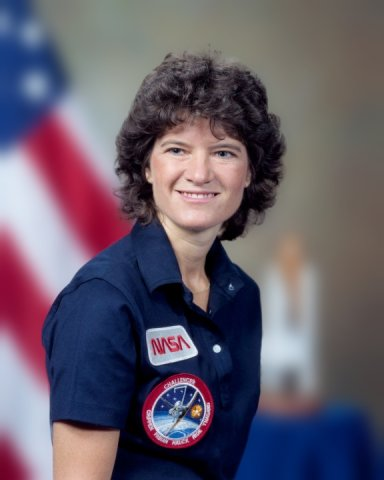
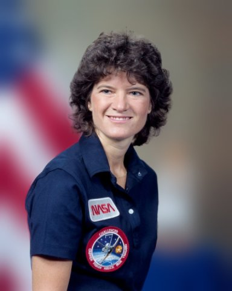
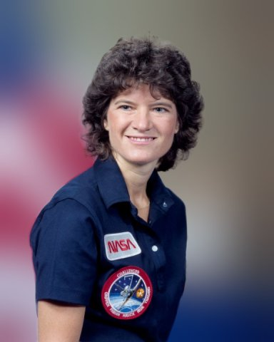
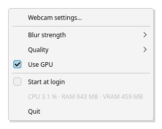
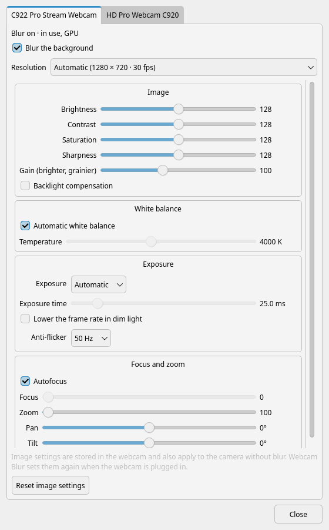

# Webcam Blur

[](https://github.com/JiPaix/webcam-blur/actions/workflows/tests.yml)

**Blur the background of your webcam on Linux, in every app:** Zoom, Teams, Google
Meet, Discord, OBS, Firefox, Chrome… Turn it on and off with one click in the tray.

| No blur | Light | Medium | Strong |
| :---: | :---: | :---: | :---: |
|  |  |  |  |

<sub>Photo: NASA portrait of astronaut Sally Ride (public domain).</sub>

## Why Webcam Blur?

- **Works everywhere.** Each webcam gets a twin called *"your webcam (blur)"*. Choose
  it in your app's camera settings, like any other camera. Your app doesn't need to
  support background blur.
- **Plug and play.** New webcams are picked up as soon as you plug them in. Nothing to
  configure.
- **One click.** Left-click the tray icon to switch the blur on or off for all your
  webcams. Right-click for the settings.
- **Your webcam's settings, kept.** Brightness, exposure, white balance, focus and zoom
  as sliders, remembered and set again whenever the webcam is plugged in.
- **Stays out of the way.** Until an app actually uses a camera, it needs about 40 MB of
  memory and next to no processor time, and the webcam stays off.
- **Light by default.** About half a processor core at 720p and 30 fps. A graphics card
  (AMD or NVIDIA) is optional: it unlocks the *High* quality and takes the load off the
  processor at higher resolutions and frame rates.
- **Private.** Everything happens on your computer. No account, no cloud, nothing sent
  anywhere.
- **In your language.** English and French so far. [Adding a language](CONTRIBUTING.md)
  only takes a text file.

## The tray icon

| <picture><source media="(prefers-color-scheme: dark)" srcset="docs/images/icon-on-dark.png"></picture> | <picture><source media="(prefers-color-scheme: dark)" srcset="docs/images/icon-live-dark.png"></picture> | <picture><source media="(prefers-color-scheme: dark)" srcset="docs/images/icon-off-dark.png"></picture> |
| :---: | :---: | :---: |
| Blur on | A camera is in use | Blur off |

Left-click the icon to turn the blur on or off for all webcams. Right-click opens the
menu.

## The tray menu



- **Webcam settings…** opens the settings window (below).
- **Blur strength:** light, medium or strong (see the pictures above).
- **Quality:** how finely the AI model looks at you. *Low*, the default, is the
  lightest, and its edges differ very little from *Standard*. *High* gives slightly
  finer edges around hair and needs a graphics card. All the numbers are in
  [Memory and speed](#memory-and-speed).
- **Use GPU:** shown only if your graphics card passed a quick test at startup.
- **Start at login.**
- A greyed-out line shows the processor, memory and graphics memory the app uses right now.

## The settings window



One tab per webcam:

- **Blur the background:** on or off for that webcam. The tab also shows whether an app
  is using it.
- **Resolution:** every resolution and frame rate your webcam supports, read from the
  webcam itself (e.g. 1080p · 30 fps or 720p · 60 fps). *Automatic* picks 720p at
  30 fps, which is what video-call apps send anyway.
- **Image:** the webcam's own controls, as it lists them: brightness, contrast, gain,
  white balance, exposure, anti-flicker, focus, zoom… Changes show straight away, even
  during a call. Settings the webcam ignores in its current mode are greyed out, such as
  the exposure time while exposure is automatic. Under the exposure time, a note says how
  long it can be before the webcam has to lower its frame rate.
- **Reset image settings** puts the webcam's defaults back.

The image settings are stored in the webcam, so they also apply to the camera without
blur. Webcams forget them when unplugged: Webcam Blur remembers the ones you changed and
sets them again whenever the webcam is plugged in or the app starts.

## Getting started

1. **Install it.** On Arch: `yay -S webcam-blur`. Other systems: see
   [Installation](#installation) below.
2. **Start "Webcam Blur"** from your applications menu. A webcam icon appears in the
   tray. Tick *Start at login* to have it every time.
3. **In your video app, select the camera ending in "(blur)"** instead of your
   webcam. That's it.

The icon's lens turns blue when the blur is on, and a red dot appears while an app is
using a camera.

## Questions

**Which apps does it work with?**
Any app that uses a webcam: Zoom, Teams, Meet and other browser-based calls, Discord,
Slack, Skype, OBS, Jitsi… If your app lists cameras, the "(blur)" ones are there.

**Will it slow down my computer?**
Only while an app uses a camera. With the default settings (720p at 30 fps, *Low*
quality), blurring takes about half a processor core on the test machine (Ryzen 7
9800X3D, Radeon RX 9070), and 210 MB of memory without the graphics card or 950 MB with
it. When no app uses a camera, it needs about 40 MB and next to no processor time. See
[Memory and speed](#memory-and-speed) for every setting.

**My computer is short on memory or power.**
Keep *Low* quality and untick *Use GPU*. The graphics card saves a little processor
time, but its drivers alone take several hundred MB of memory.

**The "Use GPU" option is missing.**
Your graphics card didn't pass the startup test, or onnxruntime was installed without
GPU support. Blurring still works, on the processor. The reason is in the log:
`journalctl --user -t webcam-blur`. On Arch, install `python-onnxruntime-rocm` (AMD) or
`python-onnxruntime-cuda` (NVIDIA).

**My processor gets busy for a few minutes after installing.**
That's normal on AMD. The AI model is compiled for your graphics card, once for each
webcam resolution and quality (1–2 minutes each, again after a graphics driver update
or when you pick a new resolution). It runs at the lowest priority, so everything else,
calls included, comes first. If a call starts before it's done, the processor does the
blurring meanwhile.

**I chose 60 fps but my app gets 30.**
Many webcams lower their frame rate in dim light to expose each picture longer. On
Logitech webcams this is *Lower the frame rate in dim light*, under *Exposure* in the
settings window: untick it. The picture gets darker instead. More light on your face
fixes both.

**How do I change brightness, focus or zoom?**
In *Webcam settings…*, under *Image*. The blurred camera shows the change straight
away, even during a call.

**Can my video app pick the resolution?**
No. Choose it in *Webcam settings…*, under *Resolution*. A new resolution applies once
no app is using the camera.

**Bits of my hair or my headphones get blurred.**
The person is detected by an AI model. It struggles with things the same colour as
the wall behind them (a white headset against a white wall, for example), with
flyaway hair and with fast movements. A background that contrasts with you, and light
on your face rather than behind you, help a lot. *High* quality helps a bit, and
*Standard* can help with fast movements (*Low* updates the cut-out 30 times a second).

## Installation

### Arch Linux and derivatives

Webcam Blur is in the [AUR](https://aur.archlinux.org/packages/webcam-blur):

```sh
yay -S webcam-blur      # or paru -S webcam-blur, or any AUR helper
```

Without an AUR helper:

```sh
git clone https://aur.archlinux.org/webcam-blur.git
cd webcam-blur
makepkg -si
```

pacman asks which onnxruntime build to install: `python-onnxruntime-rocm` for an AMD
graphics card, `python-onnxruntime-cuda` for NVIDIA, otherwise `python-onnxruntime-cpu`.
You can switch later, e.g. `sudo pacman -S python-onnxruntime-rocm`.

The `v4l2loopback` kernel module (**version 0.13 or newer**) ships with some kernels,
such as CachyOS. For other kernels, install `v4l2loopback-dkms`.

### Other distributions / from source

Requirements: Python ≥ 3.11, PyQt6, OpenCV, NumPy, pyudev, onnx, onnxruntime (a GPU
build such as `onnxruntime-gpu` for NVIDIA, or ROCm/MIGraphX for AMD), and the
v4l2loopback module (≥ 0.13). Ubuntu 24.04 only packages v4l2loopback 0.12, which
cannot create virtual cameras at runtime: build a newer one from source there.

1. Install the system files (as root):

   ```sh
   install -Dm644 data/60-webcam-blur.rules /etc/udev/rules.d/60-webcam-blur.rules
   install -Dm644 data/modprobe.conf /etc/modprobe.d/webcam-blur.conf
   install -Dm644 data/modules-load.conf /etc/modules-load.d/webcam-blur.conf
   udevadm control --reload && modprobe v4l2loopback
   ```

2. Run the app. It downloads the models to `~/.local/share/webcam-blur/models` on
   first start:

   ```sh
   python -m webcam_blur
   ```

---

## Technical details

### How it works

```
              ┌──────────── tray process (always running, ~40 MB) ───────────────┐
 udev ──────▶ │ detects webcams, creates one v4l2loopback device per webcam,     │
              │ keeps it ready (format set, black frames), shows the menu        │
              └──────────┬───────────────────────────────────────────────────────┘
                         │ an app opens "<webcam> (blur)"
                         ▼
              ┌──────────── stream process (only while an app reads) ────────────┐
 webcam ────▶ │ capture → person matting (RVM) → blurred background → writes     │ ──▶ the app
              │ through the virtual camera's file descriptor handed over by the  │
              │ tray; GPU inference in its own subprocess                        │
              └──────────────────────────────────────────────────────────────────┘
```

- **Virtual cameras** are [v4l2loopback](https://github.com/v4l2loopback/v4l2loopback)
  devices, created and removed at runtime through `/dev/v4l2loopback`. A udev rule
  gives the logged-in user access to it. The module is loaded with `devices=0`.
- **When a webcam is unplugged,** its virtual camera is removed. If an app still holds
  it open, removal waits until the app lets go. Greyscale-only devices, such as IR
  face-login cameras, are skipped.
- **The tray process never loads OpenCV, onnxruntime or a model.** When an app opens a
  virtual camera, the tray starts the stream process and hands it the virtual camera's
  already-configured file descriptor, because the format can't change under a reading
  app. Settings changes go to the stream process over stdin, and it reports its state
  on stdout. It exits a few seconds after the app closes the camera.
- **People are cut out** with [Robust Video Matting](https://github.com/PeterL1n/RobustVideoMatting)
  (ONNX Runtime). The background is blurred with a background-weighted Gaussian, so the
  person doesn't bleed into the blur.
- **Quality** sets the model and the size of the frame it sees. The cut-out is then
  scaled back to the webcam's resolution:

  | | Processor | Graphics card |
  | --- | --- | --- |
  | *Low* | MobileNetV3, 320 px wide | MobileNetV3, 640 px wide |
  | *Standard* | MobileNetV3, 640 px wide | MobileNetV3, full resolution |
  | *High* | as *Standard* | ResNet50, full resolution |

  Above 30 fps, *Low* runs the model on every other frame and reuses the cut-out in
  between. On the graphics card, models run in half precision on MIGraphX. GPU
  execution providers need fixed input sizes, so the model is converted once per size
  (`~/.cache/webcam-blur/`) and MIGraphX also compiles it once per size.
- **Models are prepared ahead of time,** for each webcam's resolution in every quality,
  in a separate process at the lowest CPU priority. The tray starts it when the GPU check
  passes and whenever a resolution or the set of webcams changes. A stream that needs a
  size nobody prepared yet runs it the same way. Each compiled model is stamped with the
  onnxruntime and ROCm versions, so an update triggers a recompile.
- **The GPU check** runs a tiny model on the GPU in a throwaway process at startup. A
  provider that silently falls back to the processor counts as a failure.

### Memory and speed

Measured on a Ryzen 7 9800X3D with a Radeon RX 9070 (ROCm 7), with a 1280×720 webcam.
Every setting delivers the webcam's full frame rate. Memory is the PSS of all the app's
processes, in the same units as the tray menu:

| | Processor, 30 fps | Processor, 60 fps | Memory | Graphics memory |
| --- | --- | --- | --- | --- |
| No app using a camera | 0.02 cores | 0.02 cores | 40 MB | — |
| Processor only, *Low* (default) | 0.6 cores | 0.8 cores | 210 MB | — |
| Processor only, *Standard* | 1.3 cores | 2.5 cores | 260 MB | — |
| GPU, *Low* (default) | 0.5 cores | 0.7 cores | 950 MB | 460 MB |
| GPU, *Standard* | 0.5 cores | 0.9 cores | 1.05 GB | 650 MB |
| GPU, *High* | 0.5 cores | 0.9 cores | 1.3 GB | 710 MB |

ROCm and MIGraphX alone take about 300 MB of memory for their libraries as soon as
anything runs on an AMD GPU, plus the compiled model kept in memory. That is why the
processor path uses much less memory. With the GPU, the processor still decodes the
webcam's video, composes the blur and converts formats. Compiling a model for a new
resolution temporarily uses more memory, outside calls.

### Configuration file

Everything is in the tray menu and the settings window. Settings are stored in
`~/.config/webcam-blur/config.json`:

| Key | Meaning |
| --- | --- |
| `strength` | `light`, `medium` or `strong` |
| `use_gpu` | `true` / `false` |
| `quality` | `low` (default), `standard` or `high` (`high` needs the GPU) |
| `language` | e.g. `"fr"`; `null` follows the system locale |
| `cameras.<id>.blur` | blur on/off for this camera |
| `cameras.<id>.mode` | resolution chosen in the settings (`{"width", "height", "fps"}`), `null` = automatic |
| `cameras.<id>.controls` | image settings changed in the settings window, e.g. `{"gain": 100}`, set again when the webcam is plugged in |
| `cameras.<id>.virtual` | `false` to never create a virtual camera for this webcam |

### Limitations

- **Apps can't negotiate the format.** A v4l2loopback virtual camera offers one format,
  the one picked in the menu. Controls changed through the virtual camera are not
  passed on to the real webcam.
- **OBS's own virtual camera** expects to load v4l2loopback with its own options. With
  `devices=0`, it may need its module options adjusted.
- **Tested hardware:** only AMD (RX 9070, MIGraphX) and processors so far. NVIDIA/CUDA
  reports are welcome.

### Development

See [CONTRIBUTING.md](CONTRIBUTING.md) for translations, the code layout and the test
suite. CI runs the unit tests on Python 3.11–3.14, end-to-end tests against the real
v4l2loopback kernel module (a fake webcam fed to the real app logic), and builds and
tests the Arch package.

## License

GPL-3.0-or-later. The Robust Video Matting models are GPL-3.0. They are downloaded at
build time or on first run, not stored in this repository.
